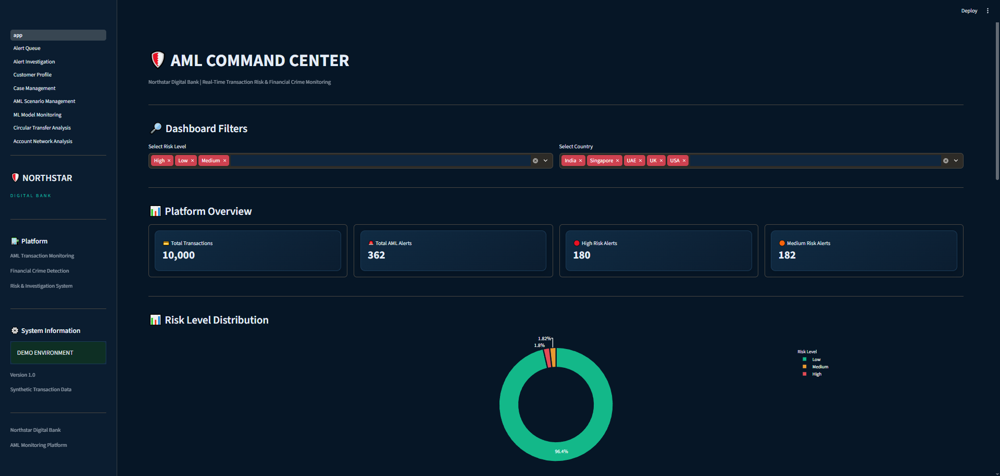

# 🛡️ Real-Time AML Transaction Monitoring & Investigation Platform

An end-to-end Anti-Money Laundering (AML) monitoring and investigation platform built using Python, Machine Learning, Network Analytics, and Streamlit.

**Organization:** Northstar Digital Bank (Fictional)  
**Project Type:** Data Science | Machine Learning | Financial Crime Analytics

## 📌 Project Overview

The platform identifies potentially suspicious financial transactions using rule-based monitoring, Machine Learning anomaly detection, unified risk scoring, and account network analysis.

It provides an interactive investigation workspace where analysts can review AML alerts, examine customer transaction activity, manage investigation cases, record decisions, and maintain audit history.

## 🎯 Key Features

- Synthetic transaction data generation (10,000 records)
- Rule-based AML transaction monitoring
- Isolation Forest anomaly detection
- Unified transaction risk scoring
- Account network analysis using NetworkX
- Circular transaction pattern detection
- Customer transaction profiling
- AML alert investigation
- Case management and investigator actions
- Audit logging and investigation history
- ML model monitoring dashboard
- Interactive Streamlit dashboard with 9 pages
- CSV export for AML alerts and analytical reports

## 🛠️ Technology Stack

| Category | Technologies |
|---|---|
| Programming Language | Python |
| Data Processing | Pandas, NumPy |
| Machine Learning | Scikit-learn, Isolation Forest |
| Network Analytics | NetworkX |
| Data Visualization | Plotly, Matplotlib |
| Database | SQLite |
| Dashboard | Streamlit |
| Development Tools | VS Code, Git, GitHub |

## ⚙️ Project Workflow

1. **Data Generation:** Generate 10,000 synthetic financial transactions.
2. **Rule-Based Monitoring:** Apply illustrative AML rules to identify suspicious transaction patterns.
3. **ML Anomaly Detection:** Use Isolation Forest to identify unusual transaction behavior.
4. **Unified Risk Scoring:** Combine rule-based scores and ML anomaly signals.
5. **Network Analysis:** Analyze account relationships and identify circular transfer patterns.
6. **Case Management:** Convert alerts into investigation cases and record investigator actions.
7. **Dashboard:** Present alerts, risk analysis, customer profiles, investigation cases, and network insights.

## 📊 Project Results

| Metric | Result |
|---|---:|
| Total Transactions | 10,000 |
| Rule-Based Alerts | 180 |
| ML Anomalies | 200 |
| Final AML Alerts | 362 |
| Circular Networks Detected | 5 |
| Accounts Involved in Detected Cycles | 20 |
| Investigation Cases Created | 362 |

*Note: Rule alerts and ML anomalies can overlap. Therefore, their individual counts do not add up to the final alert count.*

### Main Dashboard



## 🖥️ Dashboard Modules

The Streamlit application contains nine pages:

1. AML Command Center – Main Dashboard
2. Alert Queue
3. Alert Investigation
4. Customer Profile
5. Case Management
6. AML Scenario Management
7. ML Model Monitoring
8. Circular Transfer Analysis
9. Account Network Analysis

## 📁 Project Structure

```text
AML-Transaction-Monitoring/
│
├── data/
│   ├── raw/
│   ├── processed/
│   └── synthetic/
│
├── src/
│   ├── data_generation/
│   ├── rules/
│   ├── monitoring/
│   ├── scoring/
│   ├── graph/
│   └── cases/
│
├── models/
│   └── aml_isolation_forest.pkl
│
├── dashboard/
│   ├── app.py
│   └── pages/
│       ├── 2_Alert_Queue.py
│       ├── 3_Alert_Investigation.py
│       ├── 4_Customer_Profile.py
│       ├── 5_Case_Management.py
│       ├── 6_AML_Scenario_Management.py
│       ├── 7_ML_Model_Monitoring.py
│       ├── 8_Circular_Transfer_Analysis.py
│       └── 9_Account_Network_Analysis.py
│
├── reports/
│   └── graph/
│       ├── account_network.png
│       ├── account_network_metrics.csv
│       └── detected_cycles.csv
│
├── tests/
├── requirements.txt
├── .gitignore
└── README.md
```

*The SQLite case database is maintained locally and excluded from Git tracking.*

## 🚀 Installation and Setup

### 1. Clone the Repository

```bash
git clone https://github.com/Gomathi-65/AML-Transaction-Monitoring.git
cd AML-Transaction-Monitoring
```

### 2. Create a Virtual Environment

```bash
python -m venv .venv
```

### 3. Activate the Environment

Windows PowerShell:

```powershell
.venv\Scripts\Activate.ps1
```

### 4. Install Dependencies

```bash
pip install -r requirements.txt
```

### 5. Run the Dashboard

```bash
streamlit run dashboard/app.py
```

Open your browser:

`http://localhost:8501`

## 🔒 Disclaimer

This is an educational portfolio project developed using synthetic transaction data. It is not a production banking or regulatory compliance system.

Detected alerts represent potentially suspicious patterns that require further investigation. They do not establish money laundering or criminal activity.

The detection rules, thresholds, and ML results are illustrative and should not be interpreted as real-world AML compliance standards or validated financial crime detection performance.

## 👩‍💻 Author

**Gomathi Murugan**

B.Com Graduate | Data Science Learner

GitHub: [Gomathi-65](https://github.com/Gomathi-65)

LinkedIn: [Gomathi Murugan](https://linkedin.com/in/gomathimurugan-90b87a310)